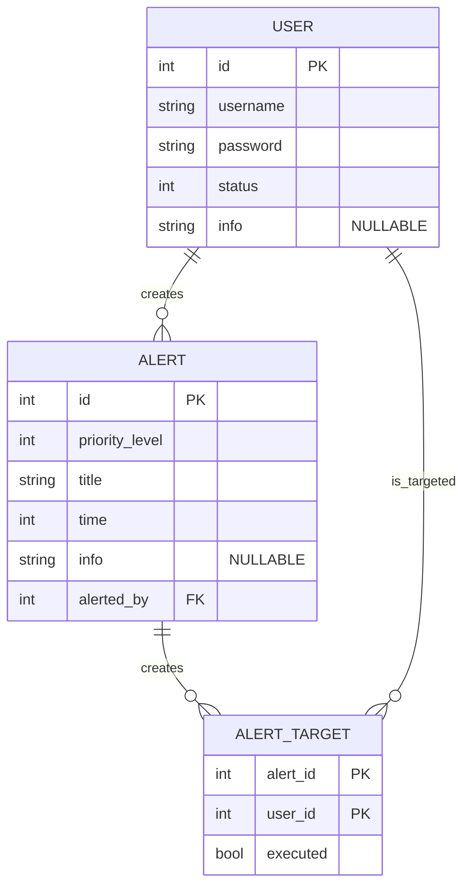

# Base comms
Protocol: `http(s)`, `SSE` \
Auth type: `username + password` \
json token, bearer token

bcrypt, argon2id


# Endpoints

---

## Overview
### GET
* `/user`
* `/user/me`
* `/user/all`


* `/status`
* `/status/me`
* `/status/all`

### POST
* `/login`
* `/status`

---

## GET
## `/user`

**Parameters:**
* `username`(URI) - string name of user

**OR**

* `/me`
* `/all`

<br>

**Returns** \
200 Successful Response
```json
{
  "username": "<name of user>",
  "status": int,
  "info": "<extra status info, set by user>"
}
```
`/user/all` returns a list of users instead.

<br>

**Exceptions:**
* `401` - invalid token / token expired
* `404` - user not found

---

## `/status`

**Parameters:**
* `username`(URI) - string name of user

OR
* `/me`
* `/all`

<br>

**Returns** \
200 Successful Response
```json
{
  "status": int,
  "info": "<extra status info, set by user>"
}
```
`/user/all` returns a list of states instead.

<br>

**Exceptions:**
* `401` - invalid token / token expired
* `404` - user not found

---

## POST
## `/login`
**Parameters:**
* `username`(form) - name of user to log into
* `password`(form) - password of user

<br>

**Returns:**\
200 Successful Response
```json
{
  "access_token": "<token>",
  "token_type": "bearer"
}
```

<br>

**Exceptions:**
* `401` - Invalid credentials

---

## `/status`
**Parameters:**
* (o) `status`(int, json) - valid integer status code
* (o) `info`(str, json) - additional information about current status

At least one of the parameters has to be specified.

<br>

**Returns:**\
200 Successful Response
```json
{
  "success": true
}
```

<br>

**Exceptions:**
* `401` - invalid token / token expired
* `404` - user not found

---

# Database


# TODO
* alerting other users
* SSE for notifications
* SSE or long polling for status updates
