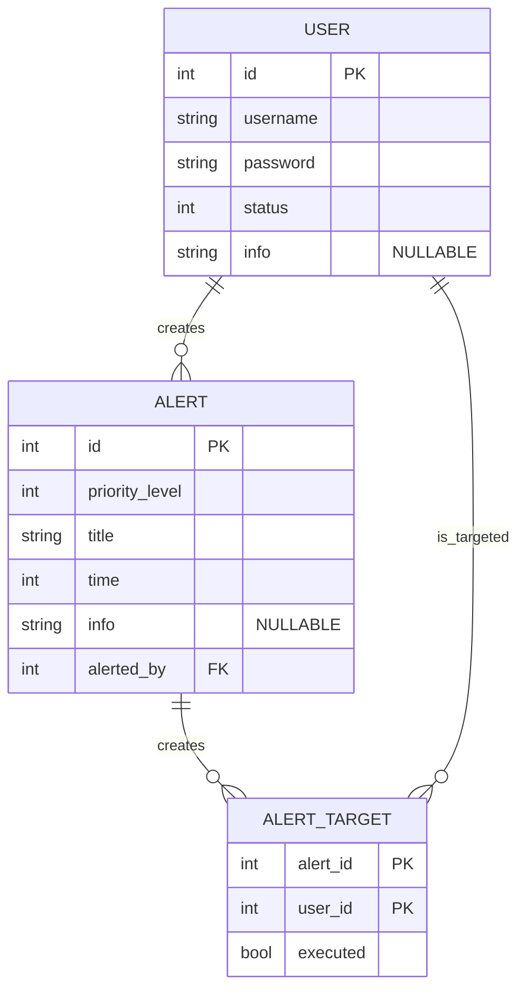

# Base comms
Protocol: `http(s)`, `SSE` \
Auth type: `username + password` \
json token, bearer token

bcrypt, argon2id


# Endpoints

---

## Overview
### GET
* `/user`
* `/user/me`
* `/user/all`

<p>

* `/status`
* `/status/me`
* `/status/all`

### POST
* `/login`
* `/register`

<p>

* `/status`

<p>

* `/alert`

### Subscriptions (SSE, GET)
* `/events`

---

## GET
## `/user`

**Parameters:**
* `username`(URI) - string name of user

**OR**

* `/me`
* `/all`

<br>

**Returns** \
200 Successful Response
```json
{
  "id": int,
  "username": "<name of user>",
  "status": int,
  "info": "<extra status info, set by user>"
}
```
`/user/all` returns a list of users instead.

<br>

**Exceptions:**
* `401` - invalid token / token expired
* `404` - user not found

---

## `/status`

**Parameters:**
* `username`(URI) - string name of user

OR
* `/me`
* `/all`

<br>

**Returns** \
200 Successful Response
```json
{
  "status": int,
  "info": "<extra status info, set by user>"
}
```
`/user/all` returns a list of states instead.

<br>

**Exceptions:**
* `401` - invalid token / token expired
* `404` - user not found

---

## POST
## `/login`
**Parameters:**
* `username`(form) - name of user to log into
* `password`(form) - password of user, unhashed

<br>

**Returns:**\
200 Successful Response
```json
{
  "access_token": "<token>",
  "token_type": "bearer"
}
```

<br>

**Exceptions:**
* `401` - Invalid credentials

---

## `/register`
**Parameters:**
* `username`(form) - name of user to register
* `password`(form) - password, unhashed

<br>

**Returns:**\
200 Successful Response
```json
{
  "success": true,
  "user": <user scheme>
}
```

<br>

**Exceptions:**
* `400` - Unhashable password
* `409` - User already registered

---
## `/status`
**Parameters:**
* (o) `status`(int, json) - valid integer status code
* (o) `info`(str, json) - additional information about current status

At least one of the parameters has to be specified.

<br>

**Returns:**\
200 Successful Response
```json
{
  "success": true
}
```

<br>

**Exceptions:**
* `401` - invalid token / token expired
* `404` - user not found

---

## Subscriptions
## `/events`
**Parameters:** -

<br>

**Returns:**
1x Start notification, then:

<br>

`user_update`:
```json
{
  "event": "user_update",
  "data": {
    "username": "<username>",
    "status": int,
    "info": "<info>"
  }
}
```

<br>

`alert`:
```json
{
  "event": "alert",
  "data": {
    "id": int,
    "priority_level": "<priority level>",
    "title": "<alert title info>",
    "info": "<optional info about alert>",
    "time": int,
    "alerted_by": "<username>"
  }
}
```


# Database


# TODO
* alerting other users
* SSE for notifications
* SSE or long polling for status updates
